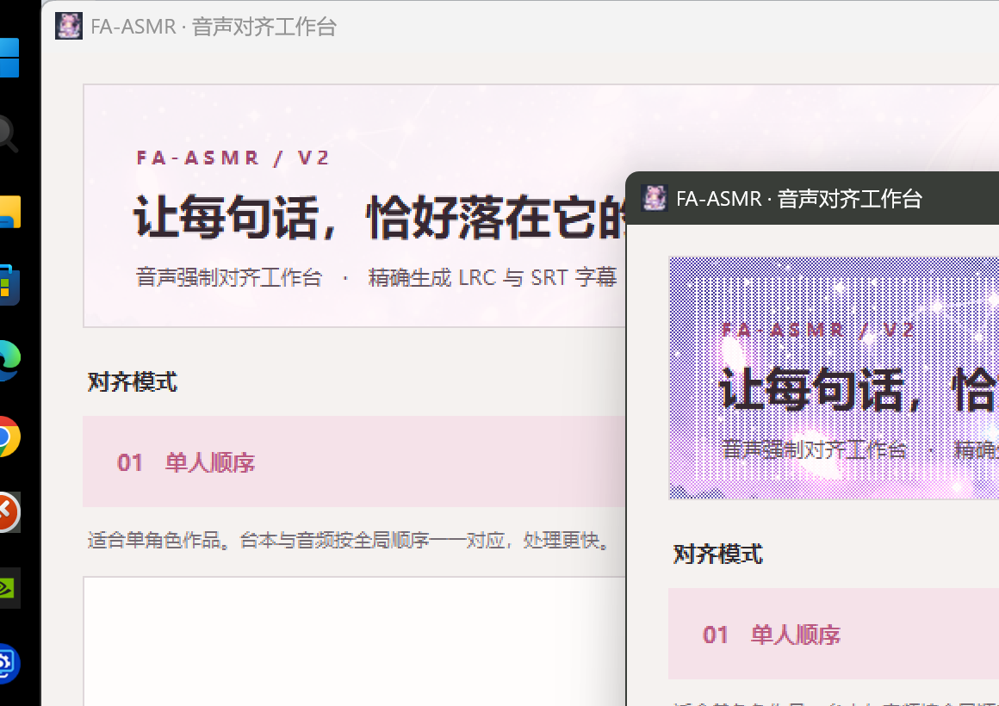

# 🌸 FA-ASMR V2 (Forced Alignment for Japanese ASMR & Voice Dramas)

[ English ](README_EN.md) | [ 简体中文 ](README.md)

> **专为日语 ASMR / 二次元音声配音打造的高精度物理声学强制对齐（打轴）引擎**
> 
> 输入「日文台本 + 人声音频」，一键输出毫秒级精确对齐的同名标准 `.lrc` 歌词与 `.srt` 双格式字幕。



---

## 一、核心优势与重大升级

在拥有官方台本的 ASMR 音声制作与汉化工作流中，传统 Whisper 等大模型盲听转录常存在弱音漏句、专有名词错写及十几秒巨型长轴粘连等痛点。FA-ASMR 采用纯声学物理强制对齐路线，并在最新版本中实现了架构级重构与升级：

- **官方台本 100% 原文保真**：直接依据官方文本做声学定位，彻底避免 ASR 盲听常见的人名、专有名词错别字与近耳低语整句吞没，译者无需二次盲听校对。
- **毫秒级子句精细化打轴**：基于声学空白与标点自动智能断行（单句 2~4 秒），并附带发音停顿即下轴的精准消失时间，告别动辄十多秒的巨型长轴，省去人工切轴与调轴。
- **双耳人头麦抗噪 (Better-Ear)**：针对 ASMR 双声道录音，原生动态选取信噪比更优的一侧，有效抑制近耳风噪、摩擦杂音与单侧环境声干扰。
- **🌟 新增：独立多人分轨混音 / 台本乱序 / 台词拟声重叠对齐引擎**：
  - 彻底打破传统单链单向时间轴假设；
  - 完美解决多人音声分轨录制、后期混音导致的**台本跨角色顺序不可靠/颠倒**问题；
  - 完美支持**双人并发重叠**（如一侧声优持续呻吟/舔耳，另一侧声优同时说主线台词）；
  - 即使台本未标注角色名，遇到局部发音颠倒时亦能自适应拆流重排。
- **🌟 新增：多视角联合对齐与动态融合引擎 (Multi-Perspective)**：
  - 针对双机位/双角色视角音声，自动通过 CTC 音素特征与声学包络互相关计算两视角时间差 $\Delta t$；
  - 构建全集主时间轴 (Union Master Timeline)，跨视角动态互斥抢占，一次性输出两视角各自独立坐标系的精准字幕。
- **🌟 新增：现代化卡片流式“夜樱亮色工作台”与中日英多语言**：
  - 界面与底层对齐引擎完全解耦，支持卡片式流式批处理；
  - 支持在界面列表内直接拖拽重排与文件配对调整；
  - 支持简体中文、日本語、English 界面无缝一键即时热切换。
- **🌟 新增：智能多编码自适应嗅探读取**：
  - 原生自适应 UTF-8（含 BOM）、Shift-JIS / CP932（DLsite 与日文声优原生台本）、GB18030 / GBK、UTF-16 等多种编码，彻底告别乱码与编码崩溃。
- **原生支持说话人标记与 LRC/SRT 双输出**：自动识别与还原 `〖角色名〗` 标签，方便多角色着色字幕制作。
- **极速与低资源占用**：Viterbi 解码核心经 Numba JIT 优化，显存占用远低于 Whisper 大模型，1 小时音频数分钟内即可完成打轴。

### 易错拟声词守门机制 (Ono Filter)

- **动作拟声与自由娇喘**：
  1. 台本上以假名记录动作声音（如 `ちゅ`、`じゅる`、`れるぅ`），但声优发出的是真实的物理亲吻音、舔舐音或吞咽声，并非字面念出假名；
  2. 台本中的呻吟词（如 `んっ`、`ふぁ…`、`あぁ…` 等），声优录制时长短、节奏自由发挥，无法与假名字面一一严密对应。  
  这两类词强行按字面对齐在绝大多数情况下都会导致时间轴撕裂错位。守门器会自动识别它们，并在对齐出现异常时将其安全平滑处理，只保留有效台词，避免破坏整体时间轴（可在设置中开关）。

---

## 二、快速开始

### 2.0 免安装预编译版（推荐普通用户）

无需安装 Python 与 PyTorch，下载解压即用，已完整内置 1.26 GB 声学模型与 LoRA 适配器：

- **CPU 版**（兼容所有电脑）：下载 `FA-ASMR-v2.0.0-Windows-CPU.zip`，解压后双击 `运行FA-ASMR.bat`；
- **CUDA GPU 版**（N 卡用户，速度极快）：下载全部分卷与 `merge_split_gpu_zip.bat` 至同一文件夹，双击该批处理自动合并解压。

下载地址：[GitHub Releases](https://github.com/zxz1994/FA-ASMR/releases/latest)

> 以下为源码运行方式，适合开发者或需要自行修改代码的用户。

### 2.1 环境准备

- **Python 版本**：推荐 Python 3.10 ~ 3.12 (64-bit)
- **硬件推荐**：NVIDIA GPU（支持 CUDA）可获得极速对齐体验；亦支持 CPU 模式（多线程 + 动态量化）

```bash
# 1. 克隆本仓库
git clone https://github.com/zxz1994/FA-ASMR.git
cd FA-ASMR

# 2. 安装核心依赖
pip install -r requirements.txt

# 3. 单独安装注音模型（其 setup 会拉入大量无关开发依赖，故不列入 requirements）
pip install --no-deps yomikata
```

> **PyTorch 说明**：
> 推荐安装 PyTorch 2.6.0：
> - CUDA 版（以 CUDA 12.4 为例）：  
>   `pip install torch==2.6.0 torchaudio==2.6.0 --index-url https://download.pytorch.org/whl/cu124`
> - CPU 版：  
>   `pip install torch==2.6.0 torchaudio==2.6.0 --index-url https://download.pytorch.org/whl/cpu`

### 2.2 模型权重准备

| 模型文件 | 存放路径 | 说明 |
|---|---|---|
| **MMS-FA 基础模型** (`model.pt`) | `models/hub/checkpoints/model.pt` | 约 1.2 GB。首次运行会自动下载，亦可手动放置于该路径实现全离线对齐 |
| **ASMR 专用 LoRA** (`fa_asmr_v9e10.pt`) | `lora/fa_asmr_v9e10.pt` | **仓库已自带**（约 12.2 MB），针对二次元日语 ASMR 拟声/动作音/耳语调优 |

### 2.3 启动程序

- **Windows 用户**：直接双击运行根目录的 `run.bat`
- **命令行启动**：
  ```bash
  python FA-ASMR_GUI.py
  ```

---

## 三、使用说明

### 3.1 界面与操作

1. **拖拽导入**：支持将音频与台本文本（`.txt`）直接批量拖入卡片工作台，程序会根据文件名自动配对。
2. **列表卡片管理**：可在列表中直接上下拖拽调整排版配对，随时暂停、重试或移除单组任务。
3. **支持音频格式**：`.wav`, `.mp3`, `.flac`, `.m4a`, `.ogg`, `.aac`, `.opus`, `.wma`。
4. **核心参数配置**：
   - **语言选择 (Language)**：支持「简体中文 / 日本語 / English」即时无缝切换。
   - **对齐模式**：
     - **常规单向对齐**：标准剧场、单人音声首选；
     - **多人/乱序重排对齐**：针对多声优交错录制、台本乱序颠倒、边说台词边呻吟等复杂场景；
     - **多视角联合对齐**：针对双机位/双视角作品自动对齐并导出各视角独立时间轴。
   - **推理设备**：可选 `cuda`（GPU）或 `cpu`。
   - **显存分块 (vram_chunk)**：显存较小可调低（如 3000~6000 帧），防止长音频 OOM。
   - **行尾时长自然延长**：为句末字幕提供更舒适的停留时间。
   - **拟声词守门开关**：开启后将自动清洗由于发音微弱或错位导致时间轴失真的孤立拟声词。

### 3.2 台本格式与智能配对规范

- **文件匹配规则**：
  - **基础同名匹配**：`01_话名.wav` 对应 `01_话名.txt`；
  - **文件名说话人声明**：支持在台本文件名尾部附加角色标签，如 `01_话名_〖澄华〗〖天音〗.txt`，程序会自动剥除说话人后缀并与 `01_话名.wav` 精准配对。
- **台本编码与内容**：
  - 支持 UTF-8、Shift-JIS、GB18030、UTF-16 自动识别；
  - **括号动作提示**：建议提前删去括号内的动作提示、背景设定、场景号等不发音内容；
  - **行内说话人标记**：支持在台本行内任意位置写入 `〖角色名〗`（U+3016 / U+3017），输出 LRC/SRT 时会自动还原保留。

### 3.3 输出产物

对齐完成后，在音频同级目录下输出同名标准 `.lrc` 与 `.srt` 字幕文件。时间戳采用标准双位百分秒：

- **LRC 格式**：
```text
[00:05.58]わぁ...! ねぇ、見てみてっ!
[00:08.62]
[00:12.30]すっごくいい景色!
[00:15.00]
```

- **SRT 格式**：带精准开始与结束下轴时间，并完整保留角色名样式标签。

### 3.4 进阶底层配置 (`advanced_config.json`)

仅供进阶用户或针对特定硬件手工修改（保存后重启生效，GUI 从不覆盖此文件）：
- `cpu_threads`：CPU 推理前向线程数（默认 `null` 为自动取物理核心数）；
- `quantize_int8`：CPU INT8 动态量化加速（默认 `null` 自动判断：CPU 开启 / GPU 关闭）；
- `cpu_chunk_cap`：CPU 模式单块最大帧数上限（默认 `2000`）。

---

## 四、模块架构

仓库代码结构清晰解耦，各功能模块职责如下：

```text
FA-ASMR/
├── assets/                     # GUI 界面横幅、图标与预览截图资源
│   ├── asmr_banner.jpg
│   ├── asmr_mascot.png
│   ├── mascot_icon.png
│   └── ui_preview.png
├── furigana/                   # 日语振假名注音系统
│   ├── fa_asmr_converter.py    # 三层注音转换与 Unicode 部首兼容
│   └── overrides.json          # 特殊读音与异读覆盖表
├── lora/                       # 模型适配权重
│   └── fa_asmr_v9e10.pt        # 生产级 ASMR 适配 LoRA 权重
├── advanced_config.json        # 底层进阶参数（只读）
├── advanced_config.py          # 底层参数加载器
├── align.py                    # 单向对齐主引擎入口
├── align_acoustic.py           # 逐帧 RMS、底噪估计、双声道 Better-Ear 融合
├── align_model.py              # MMS-FA 加载、LoRA 注入与动态量化
├── align_multiperspective.py   # 多视角联合对齐与动态融合引擎 (NEW)
├── align_multispeaker.py       # 多人分轨混音 / 台本乱序 / 台词拟声重叠对齐引擎 (NEW)
├── align_post.py               # 静音吸附、Token 时间戳回映射与单调化
├── align_trellis.py            # 全局 CTC Trellis Viterbi 解码器（Numba JIT）
├── align_utils.py              # 文本规范化、长音折叠、时间格式化
├── clause.py                   # 跨模块契约字段常量（F）与子句边界判据
├── FA-ASMR_GUI.py              # 程序主入口与批处理调度器
├── fa_asmr_ui.py               # 解耦的夜樱亮色卡片流式桌面 UI (NEW)
├── fa_asmr_i18n.py             # 中/日/英三语国际化支持模块 (NEW)
├── fa_asmr_settings.json       # GUI 界面参数持久化文件
├── haruraw2norm.py             # 汉字/假名/罗马音到 MMS-FA 音素转换
├── inline_leak_clean.py        # 内联振假名残留自动清洗
├── lrc_end_extend.py           # 字幕尾端延展处理
├── merge_short.py              # 基于声学留白的短句智能合并
├── np_compat.py                # NumPy 2.x 向下兼容垫片
├── ono_base.py                 # 易错拟声词底层模式识别
├── ono_block_corpus.py         # 拟声词黑名单词库（保留实词）
├── ono_filter.py               # 拟声词多阶段守门过滤器
├── resegment.py                # 标点驱动的声学断句重分段
├── torch_bootstrap.py          # PyTorch 运行环境检测与引导
├── build_in_ci.py              # 自动化构建打包脚本
├── FA-ASMR.spec                # PyInstaller 打包配置规范
├── requirements.txt            # Python 依赖清单
└── run.bat                     # Windows 一键启动脚本
```

---

## 五、开源协议与鸣谢

本项目基于 MIT License 开源。
- 基础对齐框架参考 Meta MMS-FA (Massively Multilingual Speech) 理念
- 日语注音与分词集成了 Fugashi (UniDic)、yomikata 及 PyKakasi
