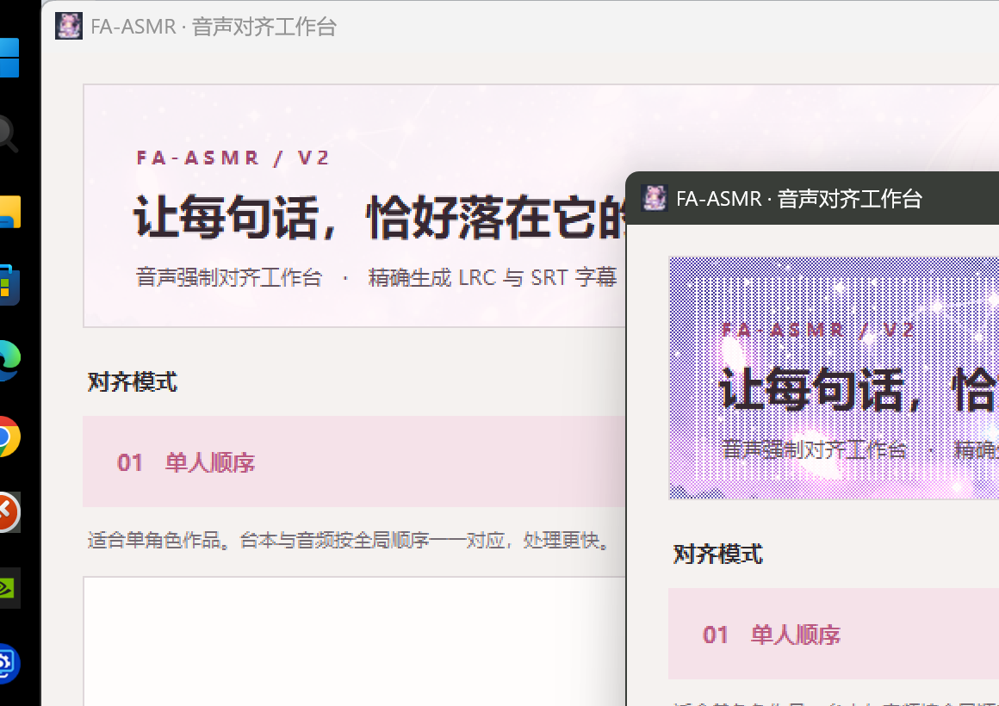

# 🌸 FA-ASMR V2 (Forced Alignment for Japanese ASMR & Voice Dramas)

[ English ](README_EN.md) | [ 简体中文 ](README.md)

> **High-precision acoustic forced alignment engine designed specifically for Japanese ASMR, drama CDs, and anime voice acting.**
> 
> Input: Japanese script (`.txt`) + Vocal audio (`.wav`, `.mp3`, `.flac`, etc.)  
> Output: Millisecond-accurate standard `.lrc` and `.srt` subtitle files with precise start/end timestamps.



---

## 1. Core Advantages & Major Updates (v2.1.0)

When subtitle makers and translators already possess official scripts (as is standard for DLsite/DMM voice dramas), using general-purpose ASR models like Whisper introduces critical issues: missed whispers, misheard character names, and bloated 10–20 second monolithic subtitle blocks. 

FA-ASMR V2 utilizes a **100% pure acoustic forced alignment architecture** (Meta MMS-FA + ASMR-specialized LoRA + Constrained CTC Trellis dynamic programming). The latest release brings major architectural upgrades:

- **100% Script Fidelity (Zero Hallucination)**: Directly aligns the official script to acoustic features. Eliminates ASR transcription errors and prevents near-ear whispers from being discarded as silence. Translators can work directly from the original script without audio proofreading.
- **Sub-clause Granularity & Natural Pauses**: Intelligently segments subtitles based on acoustic pauses and Japanese punctuation into natural reading units (typically 2–4 seconds per line). Automatically inserts empty timestamp lines upon vocal cessation, eliminating unnatural text hanging on screen.
- **Binaural Better-Ear Acoustic Fusion**: Specifically optimized for 3Dio and dummy-head stereo recordings. Evaluates log-odds ratios across stereo channels on a frame-by-frame basis to dynamically select the cleanest ear, suppressing near-ear breath pop, mouth friction, and unilateral background noise.
- **🌟 NEW: Multi-Speaker Track Mixing & Dialogue Reordering Engine (`align_multispeaker.py`)**:
  - **Prerequisite**: Script must contain clear character annotations (supports line-start/in-line `〖Character〗` tags or standalone `【Character】` headers).
  - **Problem Solved**: Multi-voice dramas are often recorded across separate tracks and mixed later, causing official script layouts by character to stagger or flip relative to actual chronological dialogue.
  - **Mechanism**: Deconstructs script lines into independent acoustic streams per character, aligns each against the audio, and merges them strictly based on empirical vocal timestamps. Prevents monolithic timeline tearing and provides robust tolerance for overlapping speech and spontaneous panting.
- **🌟 NEW: Multi-Perspective Joint Alignment Engine (`align_multiperspective.py`)**:
  - **Prerequisite**: Operates atop the multi-speaker engine; **the script must contain character tags**, and audio tracks for both Perspective A and Perspective B must be provided.
  - **Acoustic-Clear Channel Selection**: In dual-perspective recordings, the engine evaluates frame-level and clause-level acoustic confidence and energy, **automatically prioritizing the perspective where acoustic features are clearer and vocal signals are strongest**. This prevents timeline drift when a voice actor moves away from one microphone.
  - **Dual-Perspective Offset Calibration**: Uses phoneme-level feature cross-correlation to measure the inter-mic time delta $\Delta t$, builds a Union Master Timeline, and projects separate subtitle files for each perspective's native coordinate system.
- **🌟 NEW: Modern "Sakura-Light Workspace" UI (`fa_asmr_ui.py`) & Multi-language Support (`fa_asmr_i18n.py`)**:
  - Completely decoupled UI architecture supporting card-stream batch processing.
  - Drag-and-drop task reordering and script-audio pairing adjustments directly in the UI.
  - Seamless, instant hot-switching between Simplified Chinese, Japanese, and English.
- **🌟 NEW: Smart Multi-Encoding Auto-Detection (`read_text_auto_encoding`)**:
  - Native fallback sniffing for UTF-8 (with BOM), Shift-JIS / CP932 (standard for DLsite scripts), GB18030 / GBK, and UTF-16, eliminating encoding crashes.
- **🌟 NEW: Dual LRC & SRT Output Support**:
  - Outputs standard `.lrc` lyrics as well as standard `.srt` subtitles with full speaker styling preserved.
- **High Performance & Low VRAM Usage**: Accelerated by Numba JIT. VRAM consumption is a fraction of large ASR models, aligning a 1-hour drama CD in just a few minutes.

### Acting Onomatopoeia Filter (Ono Filter)

- **Physical Action Sounds & Spontaneous Moans**:
  1. Scripts often write sound effects with kana (e.g., `ちゅ` for kissing, `じゅる` for sucking, `れるぅ` for licking). However, voice actors produce actual physical mouth/body sounds rather than pronouncing kana phonemes.
  2. Kana sequences like `んっ`, `ふぁ…`, or `あぁ…` represent emotional performance directions with spontaneous pacing, pitch, and duration that rarely match the literal kana count.  
  Forcing alignment on these tokens frequently causes severe timeline distortion. The built-in Ono Filter detects these acting markers and automatically cleans stretched onomatopoeia lines while strictly preserving genuine speech dialogue.

---

## 2. Quick Start

### 2.0 Prebuilt Portable Release (Recommended for End Users)

No Python or PyTorch installation required. Unzip and run — the 1.26 GB acoustic model and LoRA adapter are bundled inside:

- **CPU edition** (works on any PC): download `FA-ASMR-v2.1.0-Windows-CPU.zip`, extract, then double-click `运行FA-ASMR.bat`;
- **CUDA GPU edition** (fast on NVIDIA GPUs): download all split parts plus `merge_split_gpu_zip.bat` into one folder, then double-click the batch file to merge and extract automatically.

Download: [GitHub Releases (v2.1.0)](https://github.com/zxz1994/FA-ASMR/releases/latest)

> The section below covers running from source, intended for developers or users who need to modify the code.

### 2.1 Environment Setup

- **Python**: Recommended Python 3.10 – 3.12 (64-bit)
- **Hardware**: NVIDIA GPU (CUDA supported) recommended for fast inference; CPU mode (multi-threading + dynamic quantization) is also supported.

```bash
# 1. Clone repository
git clone https://github.com/zxz1994/FA-ASMR.git
cd FA-ASMR

# 2. Install dependencies
pip install -r requirements.txt

# 3. Install the furigana model separately
#    (its setup pulls in many unrelated dev dependencies, hence excluded from requirements)
pip install --no-deps yomikata
```

> **PyTorch Recommendation**:
> PyTorch 2.6.0 is recommended:
> - **CUDA**: `pip install torch==2.6.0 torchaudio==2.6.0 --index-url https://download.pytorch.org/whl/cu124`
> - **CPU**: `pip install torch==2.6.0 torchaudio==2.6.0 --index-url https://download.pytorch.org/whl/cpu`

### 2.2 Model Weights

| Model | Target Path | Description |
|---|---|---|
| **MMS-FA Base Model** (`model.pt`) | `models/hub/checkpoints/model.pt` | ~1.26 GB. Automatically downloaded on first run via `torchaudio.pipelines.MMS_FA`, or can be manually placed for complete offline usage. |
| **ASMR LoRA Adapter** (`fa_asmr_v9e10.pt`) | `lora/fa_asmr_v9e10.pt` | **Included in repository** (~12.2 MB). Fine-tuned specifically on Japanese ASMR acoustics. |

### 2.3 Launching the Application

- **Windows**: Double-click `run.bat`
- **Command Line**:
  ```bash
  python FA-ASMR_GUI.py
  ```

---

## 3. Usage & Specifications

### 3.1 GUI Workflow

1. **Drag-and-Drop**: Drag multiple scripts (`.txt`) and audio files directly into the window. Pairs are matched automatically by filename.
2. **Card Task Management**: Drag up/down in the list to reorder or re-pair tasks. Pause, resume, or retry items individually.
3. **Audio Formats Supported**: `.wav`, `.mp3`, `.flac`, `.m4a`, `.ogg`, `.aac`, `.opus`, `.wma`.
4. **Key Options**:
   - **Language**: Instant hot-switching between Simplified Chinese, Japanese, and English.
   - **Alignment Mode**:
     - *01 Standard Monotonic*: Ideal for solo voice acting and single audio tracks.
     - *02 Multi-Speaker / Reordered*: Handles overlapping speech, multi-track mixing, and staggered script dialogue (script requires speaker annotations).
     - *03 Multi-Perspective*: Operates atop multi-speaker engine for dual-perspective recordings, prioritizing acoustic-clear channels and exporting independent timelines.
   - **Device**: Select `cuda` (GPU) or `cpu`.
   - **VRAM Chunk**: Lower to 3000–6000 frames if running on lower VRAM GPUs to prevent OOM.
   - **Line End Extension**: Adds a small natural delay to sentence end timestamps for more comfortable reading.
   - **Ono Gate**: Enable to prune stretched/distorted acting onomatopoeia.

### 3.2 Script Format & Pairing Conventions

- **Pairing Rules**:
  - **Identical Stems**: `01_track.wav` pairs with `01_track.txt`.
  - **Speaker Suffix**: Filenames ending with speaker tags (e.g., `01_track_〖Alice〗〖Bob〗.txt`) automatically strip the tag to match `01_track.wav` and register the speaker metadata.
- **Content Guidelines**:
  - Supports automatic detection of UTF-8, Shift-JIS, GB18030, and UTF-16.
  - Remove non-vocal stage directions, track headers, and scene descriptions inside brackets.
  - In-line speaker tags like `〖Name〗` or standalone `【Name】` headers will be preserved in the final LRC/SRT output.

### 3.3 Output Format

The output `.lrc` and `.srt` files are written to the same directory as the audio file. Timestamps follow standard centisecond precision:

- **LRC Format**:
```text
[00:05.58]わぁ...! ねぇ、見てみてっ!
[00:08.62]
[00:12.30]すっごくいい景色!
[00:15.00]
```

- **SRT Format**: Contains accurate start and despawn timestamps with full speaker styling preserved.

### 3.4 Advanced Configuration (`advanced_config.json`)

Optional low-level system settings (read-only by GUI; edit manually if needed):
- `cpu_threads`: CPU inference forward threads (`null` = auto-detect physical cores).
- `quantize_int8`: Dynamic INT8 quantization for CPU mode.
- `cpu_chunk_cap`: Maximum frame chunk cap in CPU mode (default: `2000`).

---

## 4. Architecture & Pipeline

Repository module topology:

```text
FA-ASMR/
├── assets/                     # GUI banners, mascot icons, and UI preview
│   ├── asmr_banner.jpg
│   ├── asmr_mascot.png
│   ├── mascot_icon.png
│   └── ui_preview.png
├── furigana/                   # Japanese furigana / phoneme conversion
│   ├── fa_asmr_converter.py    # 3-tier furigana generator & Unicode radical fixer
│   └── overrides.json          # Heteronym & reading override dictionary
├── lora/                       # Specialized model adapters
│   └── fa_asmr_v9e10.pt        # Production-grade ASMR LoRA weights
├── advanced_config.json        # Advanced system settings
├── advanced_config.py          # Configuration loader
├── align.py                    # Alignment pipeline orchestrator
├── align_acoustic.py           # RMS, noise floor, and binaural Better-Ear fusion
├── align_model.py              # MMS-FA loader, LoRA injection & dynamic quantization
├── align_multiperspective.py   # Multi-perspective joint alignment engine (NEW)
├── align_multispeaker.py       # Multi-speaker / scrambled script alignment engine (NEW)
├── align_post.py               # Post-processing, silence snap & timestamp monotonicity
├── align_trellis.py            # Constrained CTC Trellis Viterbi aligner (Numba JIT)
├── align_utils.py              # Normalization, prolonged sound folding, time formatting
├── clause.py                   # Data contract constants (F) & clause boundaries
├── FA-ASMR_GUI.py              # Application main entry & batch scheduler
├── fa_asmr_ui.py               # Decoupled Sakura-Light card stream UI (NEW)
├── fa_asmr_i18n.py             # Trilingual i18n support module (NEW)
├── fa_asmr_settings.json       # GUI settings persistence
├── haruraw2norm.py             # Kanji/Kana/Romaji to MMS-FA phoneme converter
├── inline_leak_clean.py        # Inline ruby residue cleaner
├── lrc_end_extend.py           # Subtitle despawn extension
├── merge_short.py              # Acoustic-pause-driven short clause merger
├── np_compat.py                # NumPy 2.x compatibility shim
├── ono_base.py                 # Onomatopoeia pattern recognition
├── ono_block_corpus.py         # Onomatopoeia blacklist
├── ono_filter.py               # Multi-stage onomatopoeia gatekeeper
├── resegment.py                # Punctuation-driven acoustic resegmentation
├── torch_bootstrap.py          # PyTorch environment detection and bootstrapping
├── build_in_ci.py              # Automated build & packaging script
├── FA-ASMR.spec                # PyInstaller packaging specification
├── requirements.txt            # Python dependencies
└── run.bat                     # Windows one-click launcher
```

---

## 5. License & Acknowledgements

This project is licensed under the MIT License.
- Base forced alignment framework references Meta's MMS-FA (Massively Multilingual Speech) paradigm.
- Japanese phoneme analysis integrates Fugashi (UniDic), yomikata, and PyKakasi.
